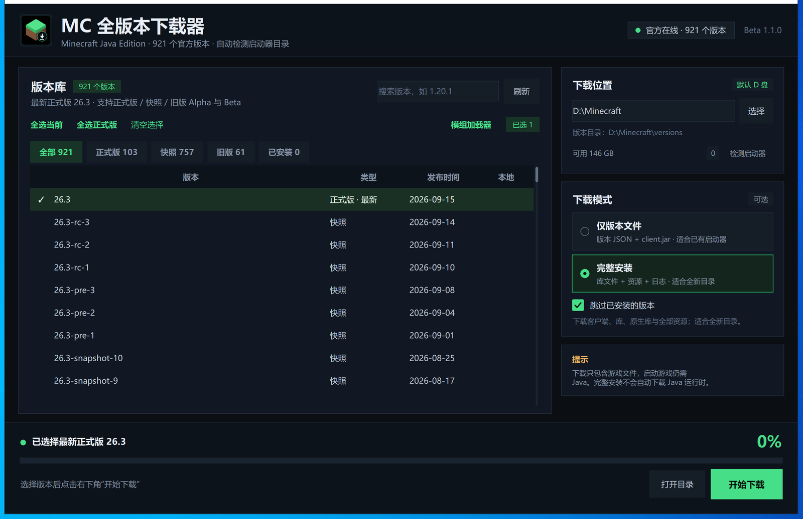

# MC 全版本下载器 Beta 1.1.0

当前软件版本：`beta1.1.0`

一个面向 Windows 的 Minecraft Java 版官方版本下载器。图形界面使用 Tkinter 编写，下载逻辑与界面分离，打包后是单文件 exe，解压/安装依赖为零。



## 功能

- 读取 Mojang 官方版本清单，支持正式版、快照、旧版 Beta、旧版 Alpha，共 900+ 个版本。
- 按类型快速筛选：**全部 / 正式版 / 快照 / 旧版 / 已安装**，每个分类显示版本数量。
- 默认下载到 `D:\Minecraft`，可随时点击“选择”切换目录，或直接输入路径。
- **应用数据目录也迁移到 D 盘**：当前版本使用 `D:\MCVersionDownloader\beta1.1.0`。每次软件版本更新会新建版本目录，并把旧版本的设置、缓存和日志复制过来，不覆盖旧目录。
- 自动检测常见启动器目录，包括官方启动器、HMCL、PCL2、Prism Launcher、MultiMC、PolyMC、BakaXL、ATLauncher、CurseForge、Modrinth App 等；也可以手动添加。
- 支持搜索、类型筛选、已安装筛选、多选、全选当前结果、全选正式版。
- **Fabric / Quilt 模组加载器下载合并**：选中一个原版版本后打开“模组加载器”，下载加载器配置和库文件，生成 `fabric-loader-…` / `quilt-loader-…` 新版本目录，启动器可以直接识别。
- 两种下载模式：
  - **完整安装**：版本 JSON、client.jar、库文件、原生库、日志配置、资源索引和全部资源对象；适合全新目录，下载后可由启动器直接识别。
  - **仅版本文件**：只下载版本 JSON 和 client.jar；适合已有启动器，体积最小。
- 下载前校验 SHA-1，使用临时 `.part` 文件，失败自动重试，已存在的文件自动跳过。
- 下载进度、文件数、总字节、速度实时显示，可随时取消。
- 下载优化：16 路并发、同主机 HTTP keep-alive 连接复用、256 KB 分块读取，减少小文件重复 TLS 握手。
- 自动缓存版本清单；断网时会使用本地缓存或内置快照启动。
- 完整安装会在版本目录写入 `.mcvdl_full.json` 标记，二次运行可以跳过已完成版本。

## 使用

1. 双击 `MC全版本下载器.exe`。
2. 确认右下角“下载位置”。默认是 `D:\Minecraft`，也可以点“选择”或“检测启动器”。
3. 在左侧勾选版本。可以搜索 `1.20.1`，或点击“正式版 / 快照 / 旧版 / 已安装”筛选。
4. 选择下载模式。默认是“完整安装”；如果只是把版本文件放进已有启动器，可以选“仅版本文件”。
5. 点击“开始下载”。

安装 Fabric / Quilt：

1. 在版本列表勾选**一个**原版版本。
2. 点击列表上方的“模组加载器”。
3. 选择加载器（Fabric / Quilt）和加载器版本。
4. 点击“下载并合并”。程序会补齐基础版本并创建新的加载器版本目录。

下载完成后，在启动器中选择对应版本即可。**本程序不下载 Java 运行时**，启动游戏仍需要启动器提供或系统安装相应版本的 Java。

## 应用数据目录

程序的应用数据（设置、版本清单缓存、日志）不再放在 `%LOCALAPPDATA%`，而是使用 D 盘：

```text
D:\MCVersionDownloader\beta1.1.0\
├─ settings.json
├─ version.json
├─ cache\
└─ logs\
```

每次版本升级会创建新的 `beta…` 目录；首次启动时自动从旧版本目录或旧的 `%LOCALAPPDATA%\MCVersionDownloader` 复制设置、缓存和日志。旧目录不会被删除。

## 下载目录说明

目标是一个“游戏根目录”，即包含 `versions` 的目录，例如：

```text
D:\Minecraft\
├─ versions\
│  └─ 1.20.1\
│     ├─ 1.20.1.json
│     └─ 1.20.1.jar
├─ libraries\
└─ assets\
```

如果选择的是某个启动器的 `.minecraft` 目录，下载会写入它的 `versions` 子目录，不会修改启动器本身。若选择的是 `versions` 文件夹本身，程序会自动识别其上一级游戏目录。

## 启动器检测

程序会扫描：

- `%APPDATA%\.minecraft`、`%USERPROFILE%\.minecraft`、`%LOCALAPPDATA%\.minecraft`
- 官方启动器 `launcher_profiles.json` 中自定义的 `gameDir`
- Prism / PolyMC / MultiMC / ATLauncher / CurseForge / Modrinth 的实例目录
- 各磁盘根目录及常见游戏目录中的 `versions`
- 名称中包含 HMCL、PCL、BakaXL 等关键字的常见目录

没有扫描到的目录可以点击“手动选择…”。检测是只读的，不会改动其他启动器。

## 从源码运行 / 构建

需要 Python 3.10+（Tkinter 随 Windows 官方 Python 一起提供）。

```powershell
python app.py
```

构建 exe：

```powershell
python -m pip install -r requirements-build.txt
powershell -ExecutionPolicy Bypass -File .\build.ps1
```

构建脚本会调用 PyInstaller 生成 `dist\MC全版本下载器.exe`，并把发布文件复制到：

- 仓库根目录的 `MC全版本下载器.exe`
- `D:\MCVersionDownloader\<版本号>\MC全版本下载器.exe`（每次版本更新新建目录）

资源文件在 `assets/`，构建时通过 `--add-data` 打包进去。

重新生成内置版本清单快照和图标：

```powershell
python tools\generate_assets.py
```

## 测试

```powershell
python -m unittest discover -s tests -v
```

测试使用本地 HTTP 服务器验证完整安装、库/原生库/资源下载、旧版资源映射、跳过逻辑、目录检测和校验和逻辑，不需要真实连接 Mojang。

## 说明与限制

- 仅支持 Minecraft Java 版原版官方版本和 Fabric / Quilt 加载器；不包含 Forge、NeoForge（官方安装器需要 Java GUI），也不包含基岩版。
- “完整安装”指下载启动所需的客户端、库和资源文件；Java 运行时、账号登录和启动器配置不在本程序范围内。
- 版本清单和资源均来自 Mojang 官方域名（`piston-meta.mojang.com`、`piston-data.mojang.com`、`libraries.minecraft.net`、`resources.download.minecraft.net`）。
- 由于 exe 未做数字签名，Windows SmartScreen 或安全软件可能提示“未知发布者”，选择“仍要运行/允许”即可；如不放心可从源码自行构建。若程序放在受保护或只读目录中，请先复制到普通可写目录（例如 `D:\MCVersionDownloader` 或桌面）再运行。
- 本工具与 Mojang / Microsoft 无关联。Minecraft 是 Mojang Studios 的商标。
