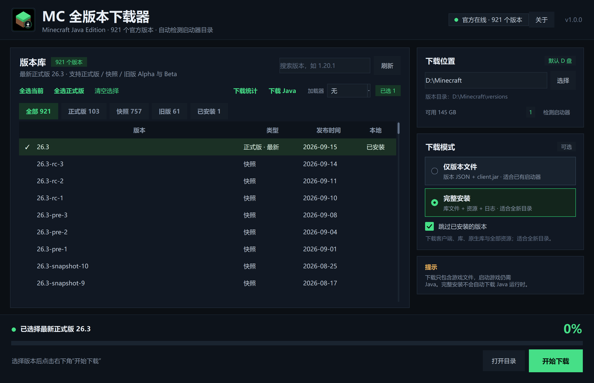
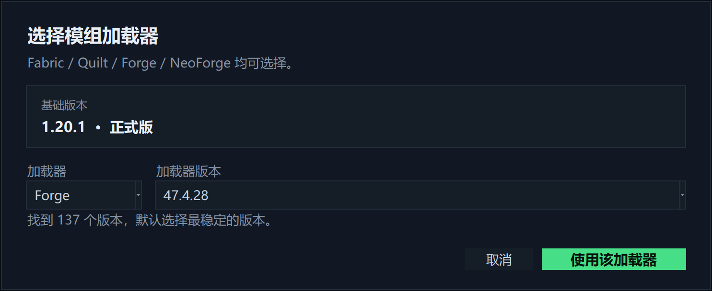
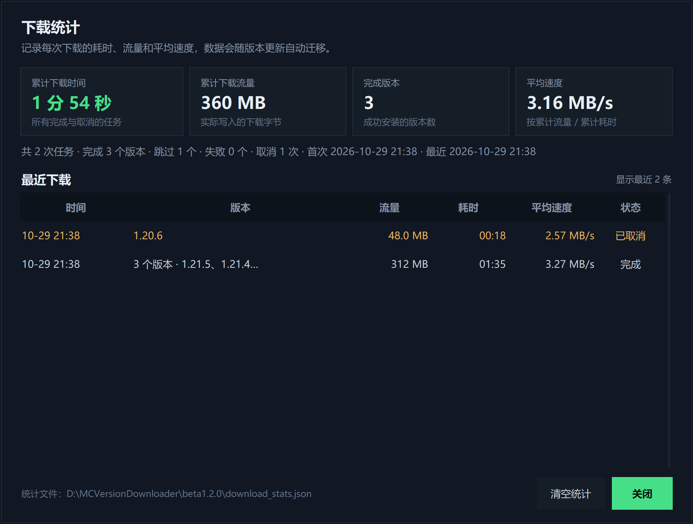
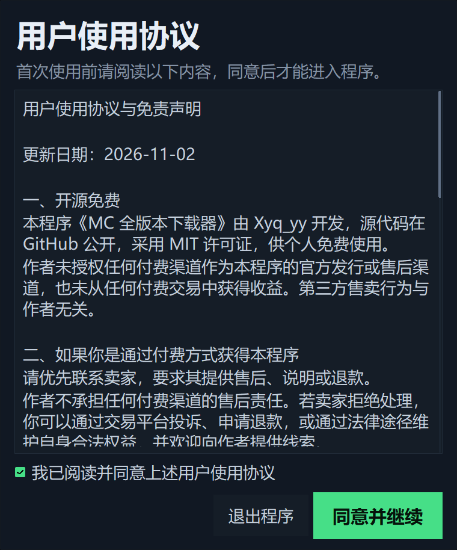
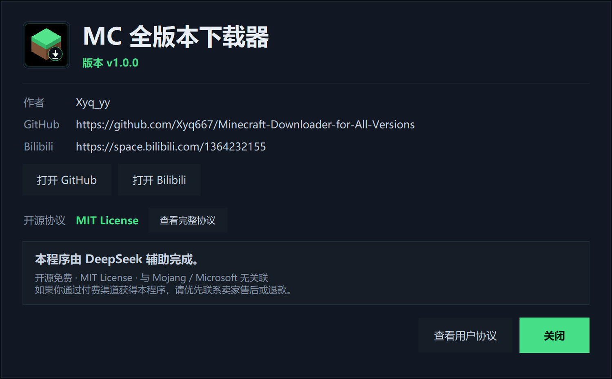

# MC 全版本下载器 v1.0.0

当前软件版本：`v1.0.0`

作者：**Xyq_yy** · [GitHub](https://github.com/Xyq667/Minecraft-Downloader-for-All-Versions) · [Bilibili](https://space.bilibili.com/1364232155)

一个面向 Windows 的 Minecraft Java 版官方版本下载器。图形界面使用 Tkinter 编写，下载逻辑与界面分离，打包后是单文件 exe，解压/安装依赖为零。



## 功能

- 读取 Mojang 官方版本清单，支持正式版、快照、旧版 Beta、旧版 Alpha，共 900+ 个版本。
- 按类型快速筛选：**全部 / 正式版 / 快照 / 旧版 / 已安装**，每个分类显示版本数量。
- 默认下载到 `D:\Minecraft`，可随时点击“选择”切换目录，或直接输入路径。
- **应用数据目录也迁移到 D 盘**：当前版本使用 `D:\MCVersionDownloader\v1.0.0`。每次软件版本更新会新建版本目录，并把旧版本的设置、缓存、日志和下载统计复制过来，不覆盖旧目录。
- 自动检测常见启动器目录，包括官方启动器、HMCL、PCL2、Prism Launcher、MultiMC、PolyMC、BakaXL、ATLauncher、CurseForge、Modrinth App 等；也可以手动添加。
- 支持搜索、类型筛选、已安装筛选、多选、全选当前结果、全选正式版。
- **模组加载器已并入下载流程**：在版本列表上方的“加载器”下拉框选择 Fabric / Quilt / Forge / NeoForge，点“开始下载”时选择加载器版本，程序会在下载原版后自动安装对应加载器版本。
  - Fabric / Quilt：下载加载器配置和库文件，生成 `fabric-loader-…` / `quilt-loader-…` 目录。
  - Forge / NeoForge：自动准备对应 Java（8/17/21/25）、下载官方安装器、预取安装依赖并运行无界面安装器，生成 `…-forge-…` / `neoforge-…` 目录。
  - 加载器只能用于单个 MC 版本；批量下载时请先把加载器切回“无”。
  - Forge / NeoForge 元数据和安装依赖优先使用官方源，失败时自动切换 BMCLAPI 镜像。
- **Java 运行时下载**：工具栏“下载 Java”可选择 Java 8 / 17 / 21 / 25，从 Mojang 官方运行时清单下载完整 JRE 文件、逐文件校验 SHA-1、解压全部文件，并显示可直接填入启动器的 `java.exe` 路径。
- **取消后可清理文件**：取消批量下载后，程序会询问是否删除本次新增的文件；删除时只删除本次写入的文件，并自动清理空目录，不影响之前已有的版本。
- **下载时间统计**：下载时底部实时显示“已用时”；每次任务结束后记录总耗时、流量、平均速度和各版本耗时。点击“下载统计”可查看累计下载时间、累计流量、平均速度以及最近 40 次下载历史，统计文件会随版本更新自动迁移。
- 两种下载模式：
  - **完整安装**：版本 JSON、client.jar、库文件、原生库、日志配置、资源索引和全部资源对象；适合全新目录，下载后可由启动器直接识别。
  - **仅版本文件**：只下载版本 JSON 和 client.jar；适合已有启动器，体积最小。
- 下载前校验 SHA-1，使用临时 `.part` 文件，失败自动重试，已存在的文件自动跳过。
- 下载进度、文件数、总字节、速度实时显示，可随时取消。
- 下载优化：32 路并发、同主机 HTTP keep-alive 连接复用、512 KB 分块读取，减少小文件重复 TLS 握手。
- **首次启动用户协议**：首次运行必须阅读并同意用户使用协议；协议强调程序开源免费，付费渠道购买请优先联系卖家售后、退款或通过法律途径维权。
- **关于页面**：显示作者 Xyq_yy、GitHub、Bilibili，并注明“本程序由 DeepSeek 辅助完成”。
- 自动缓存版本清单；断网时会使用本地缓存或内置快照启动。
- 完整安装会在版本目录写入 `.mcvdl_full.json` 标记，二次运行可以跳过已完成版本。

## 使用

1. 双击 `MC全版本下载器.exe`。首次启动需要阅读并同意用户使用协议，同意后才会进入主界面。
2. 确认右下角“下载位置”。默认是 `D:\Minecraft`，也可以点“选择”或“检测启动器”。
3. 在左侧勾选版本。可以搜索 `1.20.1`，或点击“正式版 / 快照 / 旧版 / 已安装”筛选。
4. 选择下载模式。默认是“完整安装”；如果只是把版本文件放进已有启动器，可以选“仅版本文件”。
5. 点击“开始下载”。

安装模组加载器（Fabric / Quilt / Forge / NeoForge）：

1. 在版本列表勾选**一个**原版版本。
2. 在列表上方的“加载器”下拉框选择 Fabric、Quilt、Forge 或 NeoForge。
3. 点击“开始下载”，在弹出的窗口中选择加载器版本。
4. 确认下载。程序会先下载原版，再安装加载器并创建新的可启动版本目录。

Forge / NeoForge 首次安装会自动准备匹配的 Java 运行时，并运行官方无界面安装器；安装过程可能需要几分钟。下载完成后，在启动器中选择对应版本即可。



下载 Java：

1. 点击列表上方的“下载 Java”。
2. 选择 Java 版本（8/17/21/25）。
3. 确认下载目录（默认 `D:\MCVersionDownloader\java`），点击“下载并解压”。
4. 完成后把界面显示的 `bin\java.exe` 路径填入启动器的 Java 设置。

**本程序不会自动把 Java 绑定到某个启动器**；它只是下载完整的 Java 运行时并告诉你路径。

查看下载时间统计：

1. 下载过程中，底部右侧会显示“已用时 00:00”并持续计时。
2. 下载结束后，完成提示和状态栏会显示本次总耗时及平均速度。
3. 点击版本列表上方的“下载统计”，可以查看累计下载时间、累计流量、平均速度、完成版本数和最近 40 次下载记录。
4. 统计只记录下载任务耗时，不包含启动器扫描、版本清单加载等时间；取消的任务也会记录实际耗时。



首次启动会显示用户使用协议；主界面右上角“关于”可以再次查看作者、GitHub、Bilibili 和用户协议。





## 应用数据目录

程序的应用数据（设置、版本清单缓存、日志、下载统计）不再放在 `%LOCALAPPDATA%`，而是使用 D 盘：

```text
D:\MCVersionDownloader\v1.0.0\
├─ settings.json
├─ download_stats.json
├─ version.json
├─ cache\
└─ logs\
```

每次版本升级会创建新的 `beta…` 目录；首次启动时自动从旧版本目录或旧的 `%LOCALAPPDATA%\MCVersionDownloader` 复制设置、缓存、日志和下载统计。旧目录不会被删除。

## 下载目录说明

目标是一个“游戏根目录”，即包含 `versions` 的目录，例如：

```text
D:\Minecraft\
├─ versions\
│  └─ 1.20.1\
│     ├─ 1.20.1.json
│     └─ 1.20.1.jar
├─ libraries\
└─ assets\
```

如果选择的是某个启动器的 `.minecraft` 目录，下载会写入它的 `versions` 子目录，不会修改启动器本身。若选择的是 `versions` 文件夹本身，程序会自动识别其上一级游戏目录。

## 启动器检测

程序会扫描：

- `%APPDATA%\.minecraft`、`%USERPROFILE%\.minecraft`、`%LOCALAPPDATA%\.minecraft`
- 官方启动器 `launcher_profiles.json` 中自定义的 `gameDir`
- Prism / PolyMC / MultiMC / ATLauncher / CurseForge / Modrinth 的实例目录
- 各磁盘根目录及常见游戏目录中的 `versions`
- 名称中包含 HMCL、PCL、BakaXL 等关键字的常见目录

没有扫描到的目录可以点击“手动选择…”。检测是只读的，不会改动其他启动器。

## 从源码运行 / 构建

需要 Python 3.10+（Tkinter 随 Windows 官方 Python 一起提供）。

```powershell
python app.py
```

构建 exe：

```powershell
python -m pip install -r requirements-build.txt
powershell -ExecutionPolicy Bypass -File .\build.ps1
```

构建脚本会调用 PyInstaller 生成 `dist\MC全版本下载器.exe`，并把发布文件复制到：

- 仓库根目录的 `MC全版本下载器.exe`
- `D:\MCVersionDownloader\<版本号>\MC全版本下载器.exe`（每次版本更新新建目录）
- `D:\xyq\mc-version-downloaderbeta1.0.0\MC全版本下载器.exe`（项目工作目录）
- `releases\<版本号>\`：exe、README、界面截图和 `MCVersionDownloader-<版本号>-source.zip` 源码包
- 项目根目录的 `MCVersionDownloader-<版本号>-all.zip`：源码 + exe + 文档的完整压缩包

资源文件在 `assets/`，构建时通过 `--add-data` 打包进去。

重新生成内置版本清单快照和图标：

```powershell
python tools\generate_assets.py
```

## 测试

```powershell
python -m unittest discover -s tests -v
```

测试使用本地 HTTP 服务器验证完整安装、库/原生库/资源下载、旧版资源映射、跳过逻辑、目录检测、校验和逻辑，以及下载耗时统计的累计、历史上限、损坏文件容错和清空逻辑，不需要真实连接 Mojang。

## 上传 GitHub

仓库已经按可上传结构整理：

- `.gitignore` 忽略构建缓存、运行数据、日志和 `dist/` 临时产物
- `LICENSE` 为 MIT
- `.github/workflows/build.yml` 在推送标签（如 `v1.0.0`）时自动构建 Windows exe 并上传 Release
- 建议把 exe 作为 Release 附件发布，而不是提交二进制到 Git 历史

首次上传示例：

```powershell
git init
git add .
git commit -m "Release MC Version Downloader v1.0.0"
git branch -M main
git remote add origin https://github.com/<your-name>/<repo>.git
git push -u origin main
```

## 说明与限制

- 支持 Minecraft Java 版原版官方版本，以及 Fabric / Quilt / Forge / NeoForge 加载器；不包含基岩版。
- “完整安装”指下载启动所需的客户端、库和资源文件；Java 运行时可通过“下载 Java”获取，但账号登录和启动器配置不在本程序范围内。
- 版本清单和资源均来自 Mojang 官方域名（`piston-meta.mojang.com`、`piston-data.mojang.com`、`libraries.minecraft.net`、`resources.download.minecraft.net`）。
- 由于 exe 未做数字签名，Windows SmartScreen 或安全软件可能提示“未知发布者”，选择“仍要运行/允许”即可；如不放心可从源码自行构建。若程序放在受保护或只读目录中，请先复制到普通可写目录（例如 `D:\MCVersionDownloader` 或桌面）再运行。
- 本工具与 Mojang / Microsoft 无关联。Minecraft 是 Mojang Studios 的商标。
- 开源协议：**MIT License**，Copyright (c) 2026 Xyq_yy；完整协议可在程序“关于 → 查看完整协议”中阅读。
